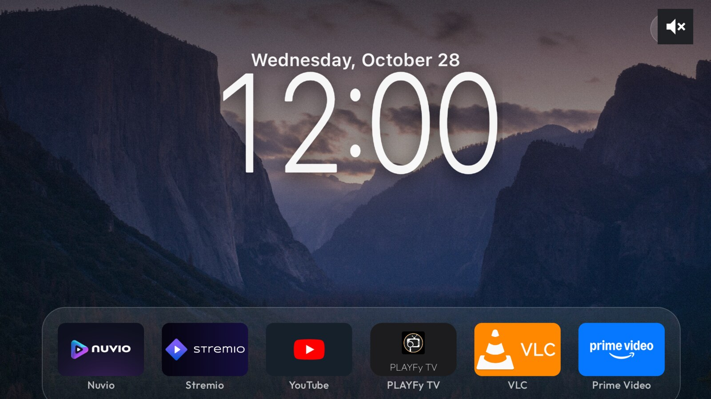
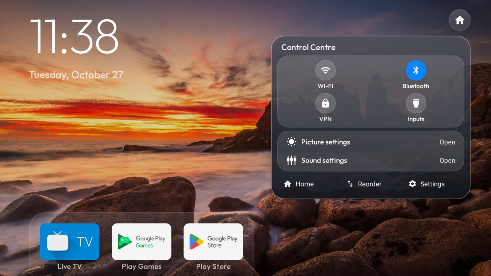
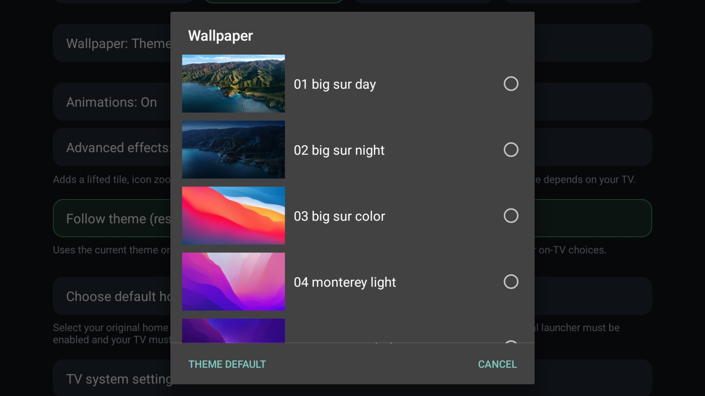

# tvOS-style polish for the launcher

This fork of [cleanyourtv](https://github.com/Gathin23/cleanyourtv) carries a set of launcher
changes built on a Chromecast with Google TV: a tvOS-style home screen, a real control centre,
and a wallpaper picker that does not stall the UI thread. Everything below was built, reviewed
and run on the device before it was committed.

| Home | Control centre | Wallpaper picker |
|---|---|---|
|  |  |  |

Home is a capture from the TV itself. The control centre and the picker were captured on a
TV-sized emulator running the identical APK (same 1920×1080 @ 320 dpi), because remote D-pad
injection over `adb` kept landing on dock tiles instead of the settings gear — a limitation of
injecting keys into a focus-moving launcher, not of the build.

## What changed

**Home.** Pale SF-style light clock with a date line over a textured wallpaper, a six-app dock,
and a gear affordance top-right. The clock, hero art, top fade, VPN badge and edge glow were
reworked in `ClockScene`, `HeroArt`, `TopFade`, `VpnBadge`, `EdgeGlow`, `DepthClockOverlay` and
`LockClockPlacement`, with layout changes in `activity_main.xml` and `item_app.xml`.

**Control centre.** A compact translucent panel (`panel_control_center.xml`,
`glass_control_center.xml`, `cc_*` drawables) with Wi-Fi / Bluetooth / VPN / Inputs chips, then
Picture settings and Sound settings rows that launch the **real vendor screens** through
`Settings.ACTION_*` intents — no imitation sliders with no effect behind them. Footer carries
Home / Reorder / Settings. Chip state is read from the system on open, so it reflects reality
rather than a remembered toggle.

**Wallpaper picker.** 32 wallpaper thumbnails plus `None` and a neutral `Theme default` action,
shown in a dialog with a three-column grid. Behaviour that matters:

- Thumbnails are decoded on **one worker thread** at a sampled size (`inSampleSize`), never on
  the main thread, and cached per file name. The adapter asks for a bitmap; a miss kicks off a
  decode and shows a placeholder until it lands.
- A file that fails to decode is recorded in a `failed` set and never retried, so a corrupt
  wallpaper cannot cause a rebind loop.
- Teardown is **one idempotent, identity-checked path** shared by the dialog's dismiss listener
  and by `onDestroy()`. A decode that finishes after the dialog closed recycles its bitmap and
  returns instead of repopulating a cache nobody can see, and killing the activity with the
  dialog still up (HOME, config change, process trim) does not leak the window or the worker.
- The worker wraps the decode in `try/catch (Throwable)` — an OOM on a huge JPEG goes to the
  `failed` path instead of the thread's uncaught handler, which would take the launcher down.
- Selection persists through the existing wallpaper preference; `Theme default` clears it.
- Thumbnails use `setCompoundDrawablesRelative`, so Hebrew layouts put the image on the right.

## Notes worth keeping

- **Measure before optimising.** The original picker decoded 32 wallpapers inside `getView()`.
  After the move, a 30-step D-pad scroll measured 4 janky frames out of 118 (3.39%) with zero
  slow-UI frames and zero missed vsync.
- **Hide a view by id, not by parent.** The slider track was hidden via `getParent()` on a child;
  replacing it with the id on the grid container (`R.id.ccsTrack`, the `FrameLayout` holding the
  fill) removed an assumption about view hierarchy that would break on any layout tweak.
- **Two teardown triggers, one teardown function.** `OnDismissListener` alone is not enough: if
  the activity dies while the dialog is showing, the listener never runs and the non-daemon
  worker thread outlives the activity.
- **Identity-check the cleanup.** A stale dismiss callback that closes "the current loader" can
  close a newer one. `releasePreviews(loader, dialog)` nulls the fields only when they are the
  same instances it was handed.
- Translucent panels need real assets: `cc_card`, `cc_chip_on/off`, `cc_row_focus`,
  `cc_slider_*` and `glass_control_center` are layered drawables rather than alpha-blended views,
  which keeps focus and pressed states crisp at 1080p.

## Verification

- `./gradlew :app:assembleRelease :app:testReleaseUnitTest :app:lintRelease` — build success,
  286 unit tests / 0 failures, lint 0 errors (85 warnings, 150 information).
- Emulator + TV, same APK sha256: thumbnails render, a chosen wallpaper persists across reopen,
  `Theme default` clears the selection, and both teardown paths (BACK dismiss, HOME with the
  picker open) produced **0 WindowLeaked / 0 FATAL / 0 RejectedExecution** in logcat.
- Independent review, three rounds: PASS, PASS, PASS.

Known limitations, kept honest:

- Double-opening the picker is not guarded; no current UI path reaches it.
- A running decode keeps the adapter alive for at most one sampled decode after close.
- The picker and control-centre screenshots come from the emulator, not the TV.

## Build and install

Upstream's scripts still apply. With a TV reachable over wireless debugging:

```fish
set -gx TV_HOST <tv-ip>:5555
./launcher/build-and-install.sh
```

The release variant is what was tested on the device; `assembleRelease` then
`adb -s $TV_HOST install -r` is the short path.

## Licence

MIT, © 2026 Gathin — this fork keeps the upstream `LICENSE`. The Outfit typeface ships under the
SIL Open Font License 1.1 (`launcher/FONT-LICENSE-OFL.txt`).
